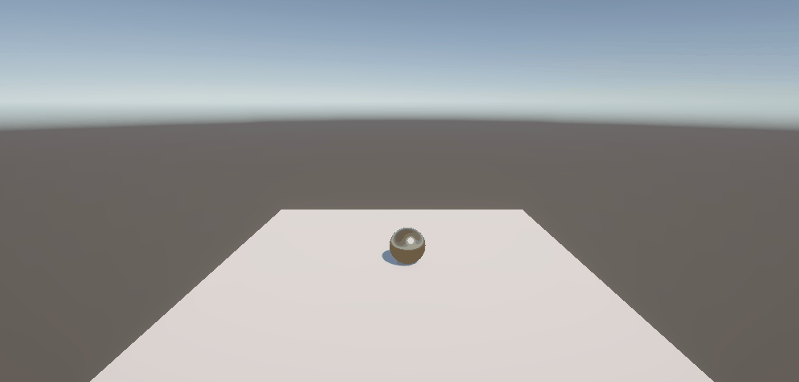
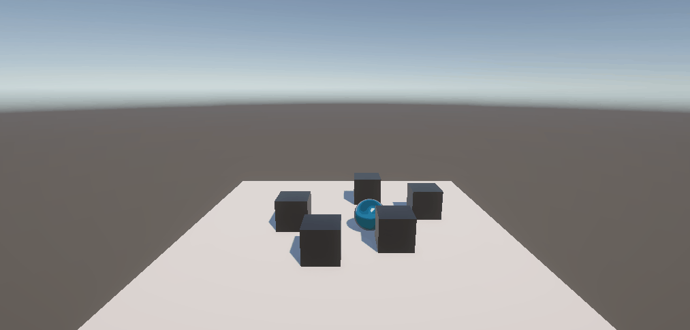
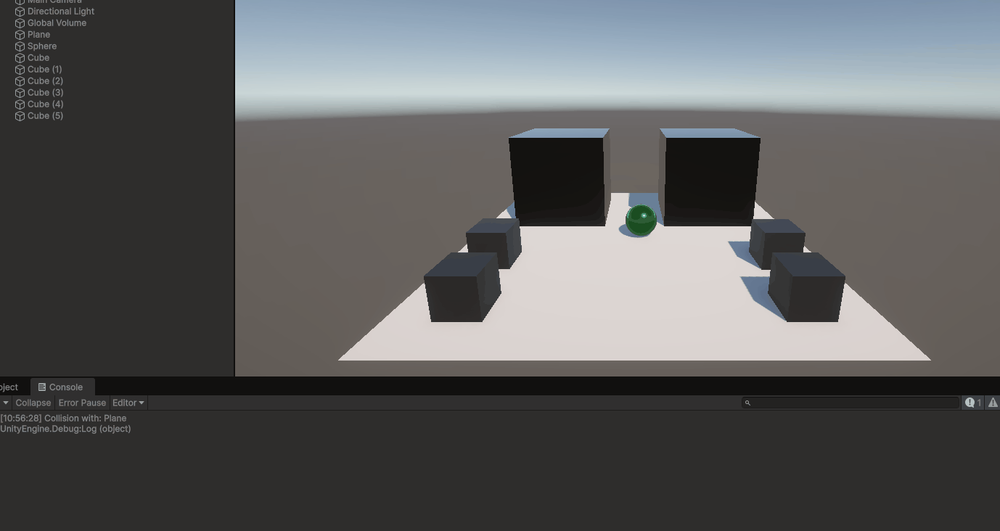
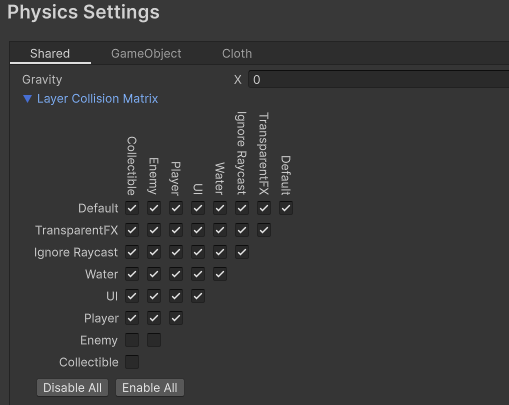
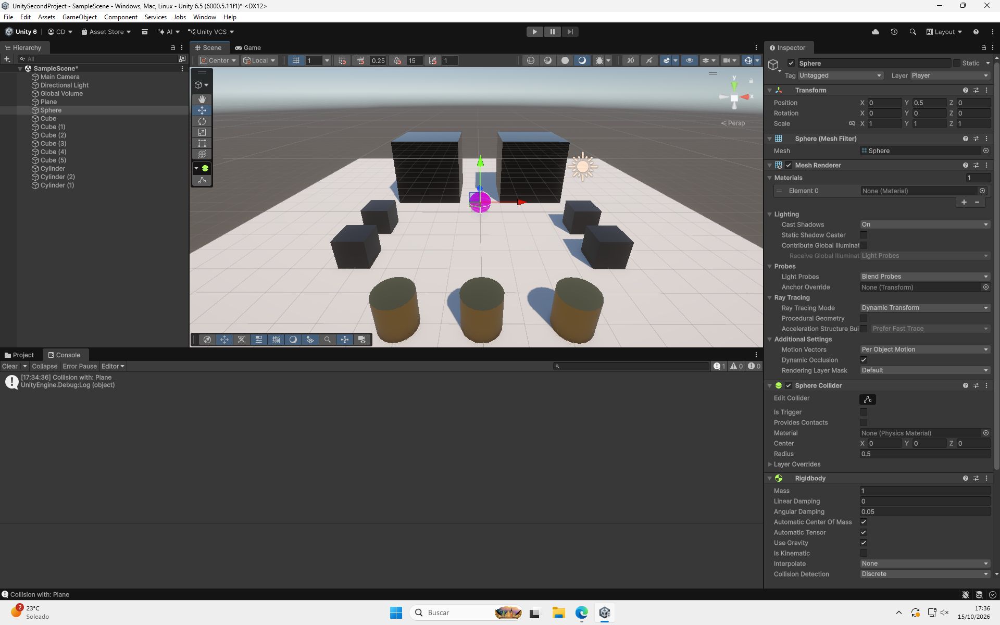
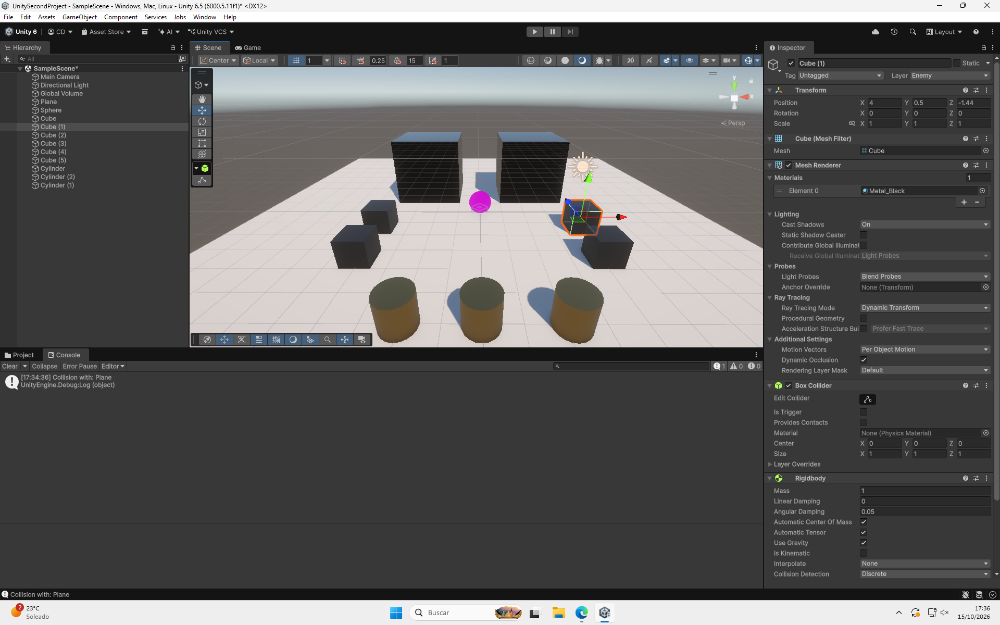
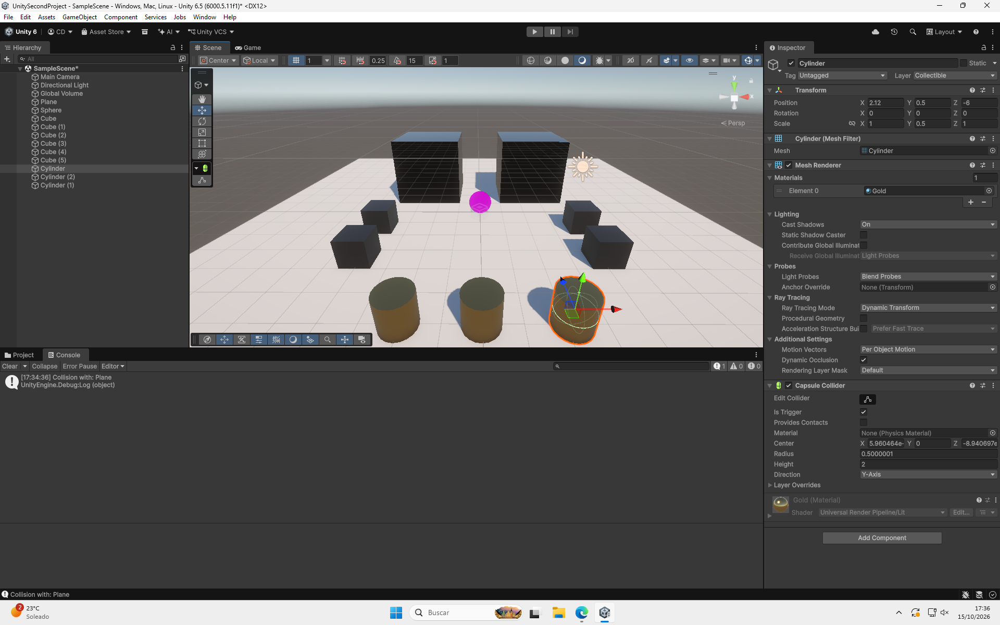
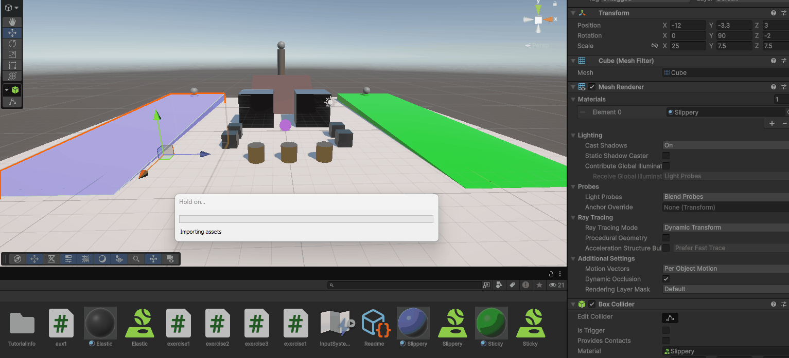

# Physic exercises

## Introduction

To provide clear context on how Unity's physics system handles collisions, 
movement, and trigger callbacks across different object configurations, the 
table below outlines the primary component setups and their expected behaviors:

| Type | Moved by Physics? | Moved by Transform? | Physical Response (Collision) | C# Events Triggered |
| :--- | :---              | :---                | :---                          | :---                |
| **Dynamic Rigibody**  | Yes (gravity, forces, collisions) | No | Solid (blocks, bounces, and stops against other solids) | OnCollision events |
| **Dynamic Rigibody (Trigger)** | Yes | No | Intangible (passes through objects without physical impact) | OnTrigger events |
| **Kinematic Rigibody** | No | Yes | Solid (pushes dynamic objects; unyielding to external forces) | OnCollision events *(when interacting with Dynamic objects)* |
| **Kinematic Rigibody (Trigger)** | No | Yes | Intangible (acts as a movable detection zone) | OnTrigger events |
| **Static** | No | No | Solid (immovable environmental barrier) | OnCollision events *(executed on the colliding Rigidbody object)* |
| **Static (Trigger)** | No | No | Intangible (stationary detection area) | OnTrigger events |

## Situations

Based on the experimental tests conducted across all configuration scenarios, 
the observed physics interactions, movement outcomes, and collision behaviors 
are summarized in the table below:

| Scenario | Plane Configuration | Cube Configuration | Sphere Configuration | Observed Behavior / Outcome |
| :---     | :---                | :---               | :---                 | :---                        |
| **Situation 1** | Static (Collider only) | Dynamic Rigidbody | Static (Collider only) | The cube falls onto the plane due to gravity and physically stops. The sphere remains suspended or unaffected by gravity, acting as a static obstacle. |
| **Situation 2** | Static (Collider only) | Dynamic Rigidbody | Dynamic Rigidbody | Both the cube and sphere fall under gravity, land on the plane, and physically interact/collide with each other upon contact. |
| **Situation 3** | Static (Collider only) | Dynamic Rigidbody | Kinematic Rigidbody | The cube drops under gravity. The sphere ignores external forces/gravity; if moved into the cube, it pushes the cube without being affected itself. |
| **Situation 4** | Dynamic Rigidbody | Dynamic Rigidbody | Dynamic Rigidbody | All three objects respond to gravity. Unless constrained, the plane itself falls continuously along with the cube and sphere. |
| **Situation 5** | Kinematic Rigidbody | Dynamic Rigidbody | Dynamic Rigidbody (10× Mass) | The plane remains stationary while supporting objects. Upon collision, the heavier sphere easily impacts and displaces the lighter cube with noticeable momentum transfer. |
| **Situation 6** | Kinematic Rigidbody | Dynamic Rigidbody | Dynamic Rigidbody (100× Mass) | The plane stays fixed in place. The massive sphere pushes or scatters the cube with extreme force, behaving almost like an unyielding obstacle on contact. |
| **Situation 7** | Dynamic Rigidbody | Dynamic Rigidbody | Dynamic Rigidbody (with Friction) | All objects respond to gravity. The high friction on the sphere reduces its sliding/rolling velocity across the plane upon impact or slope movement. |
| **Situation 8** | Kinematic Rigidbody | Dynamic Rigidbody | Static (Collider only) (Is Trigger) | The plane stays fixed. The cube physically lands on the plane, but passes straight through the sphere without physical displacement, triggering overlap events instead. |
| **Situation 9** | Kinematic Rigidbody | Dynamic Rigidbody | Dynamic Rigidbody (Is Trigger) | The plane remains fixed. The sphere responds to physics/triggers overlap callbacks, but allows the cube (and other colliders) to pass directly through its mesh. |

---

## Scripts

* **Exercise 1**:

The main purpose of this exercise is to implement movement using a Rigidbody 
component while ensuring precise and direct control over its linear 
displacement via user input.

The script retrieves the object's Rigidbody component in the `Start()` method 
and stores it in the rigibody variable. During each frame in the `Update()` 
method, `UpdateDirection()` reads raw input from Unity's virtual axes using 
`Input.GetAxisRaw()`. This input is combined into a 3D direction vector along 
the X and Z axes and normalized to guarantee consistent movement speed in all 
directions, including diagonally.

To ensure proper interaction with Unity's physics engine, the movement is 
applied inside `FixedUpdate()` by directly setting `rigibody.linearVelocity` to 
the calculated direction vector.

As a result, the character can be controlled smoothly using either the WASD 
keys or the arrow keys, with physics-based velocity updates providing total 
control over its movement across the plane, as illustrated below.

* **Exercise 2**:

The main purpose of this exercise is to detect collisions between physical 
objects and respond by logging collision data and dynamically altering visual 
appearance.

When a collision occurs with any dynamic physics object in the scene, the 
script captures the interaction automatically. It extracts the name of the 
colliding object and prints a descriptive message to the Unity Console. 
Immediately following the impact, a new color is generated using random RGB 
values and applied directly to `objectRenderer.material.color`.

As a result, colliding with other dynamic cubes outputs the collided 
object's name to the Console while instantaneously changing the object's 
material color upon impact, as illustrated below.

* **Exercise 3**:

The main purpose of this exercise is to handle spatial trigger detection to 
apply temporary visual modifications and update internal state variables 
based on areas.

The scene defines two distinct trigger zones using `ColorZone` and `DamageZone` 
tags. When entering a color zone, the object saves its original color and 
randomly shifts its material to a new color, restoring the original appearance 
as soon as it leaves the boundary. When passing through a damage zone, the 
script increments an internal counter and outputs the updated damage level 
directly to the Unity Console.

As a result, crossing the second area continuously tracks and logs damage 
increments, while entering the first area temporarily changes the character's 
color until exiting as illustrated below.

* **Exercise 4**:

The main purpose of this exercise is to configure the Layer Collision Matrix in 
Unity to enforce selective collision and trigger filtering and organize scene 
entities into dedicated Physics Layers.

Three custom layers were created: Player, Enemies, and Collectibles, with each 
corresponding GameObject assigned to its proper layer in the Inspector. In the 
Physics settings (Edit → Project Settings → Physics), the Layer Collision 
Matrix was configured so that Enemies only register physical collisions with 
the Player, ignoring each other and other environmental objects. Additionally, 
Collectibles were set up with trigger colliders to ensure they are strictly 
detected via trigger events without physical displacement.

As a result, the physics engine enforces selective interactions where enemies 
physically obstruct only the player, while collectibles act exclusively as 
pass-through triggers, as shown in the screenshots below.

* **Exercise 5**:

The main purpose of this exercise is to experiment with different Unity Physics 
Materials to observe how distinct physical properties like friction and 
bounciness affect object interactions when launched by external forces.

To test these behaviors, three parallel ramps were created in the scene, each 
assigned a unique Physics Material: slippery, elastic, and sticky. When 
pressing the 'X' key, an impulse force is applied to the objects on each ramp, 
causing them to slide, bounce, or stick depending on their assigned surface 
properties.

As a result, each object reacts differently along its respective ramp upon 
receiving the applied force—sliding effortlessly on the slippery ramp, bouncing 
down the elastic ramp, and adhering smoothly to the sticky ramp, as illustrated 
in the GIF below.

* **Exercise 6**:

The main purpose of this exercise is to move an object toward a target and 
detect overlap with an obstacle without using a Rigidbody.

Three aligned objects with Colliders (sphere, cube obstacle marked with is 
trigger and target cylinder) are placed in the scene without physical bodies. 
The sphere moves continuously toward the cylinder, periodically checking if its 
collider bounding box intersects with the cube's bounding box. Upon detecting 
contact, the cube's material changes immediately before the sphere completes 
its trajectory to the target.

As a result, the sphere travels toward the cylinder and updates the cube's 
visual appearance the moment their colliders touch, as illustrated in the 
GIF below.

## Other information

This code was developed by 
* [Cristhian Adoney Cruz Delgado](https://github.com/CristhianCruzDelgado)

Contact emails 
* <alu0101648293@ull.edu.es>

This code was designed for Intelligent Interfaces, \
signature of the Computer Engineering degree, \
that is studied at the Univeridad de La Laguna.

_16 October 2026_
